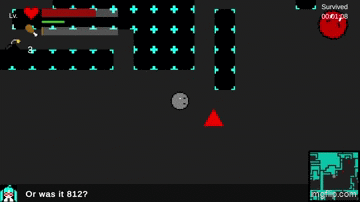

# MazeTrix

A survival game set in an infinite, procedurally generated maze. Manage your health and hunger, fight enemies that grow stronger the longer you last, and see how long you can survive.

Built in Unity for the CSC 4350 Software Engineering Capstone Project (Group 4, Spring 2026) at Georgia State University.



## Overview

You wake up in a maze that never ends. New chunks of maze generate as you explore, enemies hunt you, and your hunger keeps ticking down. Your survival time is your score. Each player has an account, and the game saves your progress and world to the cloud, so you can pick up where you left off.

A narrator, Dr. 9524, watches your run and comments on it as you play.

## Controls

| Key | Action |
| --- | --- |
| Arrow keys | Move |
| X | Melee attack |
| Z | Place a bomb |
| ESC | Pause menu |

## Gameplay

- **Health and hunger:** Hunger drops by 1 every 10 seconds. At 0 you starve and lose health instead. Food restores hunger, and health potions restore health.
- **Pickups:** Health potions, food, bombs, and a temporary speed boost are scattered through the maze.
- **Bombs:** Press Z to place a bomb. After a short fuse it damages anything nearby (including you) and blasts open maze walls, which you can use to escape enemies or reach new areas.
- **Traps:** Hidden traps look like normal floor. Stepping on one deals 10 damage once, then reveals it.
- **Enemies:** Enemies patrol, chase you when they have line of sight, and give up and return to their spawn if they lose you for 5 seconds. They are larger than you, so one-tile gaps are a way to shake them.
- **Leveling:** Enemy kills give 50 XP and items give 10 XP. Each level adds +10 max health (with a full heal), +5 attack damage, and a faster attack (down to a 0.2 s cooldown).
- **Rising difficulty:** For every minute you survive, enemies gain 15% health, 5% speed, 5% faster attacks, and 0.5 more sight range. Health, speed, and attack speed are capped.
- **Death:** The "YOU DIED" screen shows your survival time. Your next run starts fresh at Level 1.
- **Minimap and narrator:** A minimap shows the loaded chunks around you, and the narrator comments every 30 seconds based on what you have been doing.

## Getting started

### Play the build (Windows)

The Unity build and Firebase setup are made to work on **Windows only**.

1. Download `Final v1.0.2 zip.zip` from the [`Build Zips`](Build%20Zips) folder.
2. Extract the contents.
3. Run `MazeTrix_Capstone.exe` from the extracted folder.
4. Register an account, then log in with it.
5. Click **START**.
6. To quit and keep your progress, press **ESC** to open the Pause menu and choose **Return to Main Menu**. Force-closing the game does not save.

## How it works

### World generation

Each 33×33-cell chunk is built by `DungeonGenerator_v4` in this order:

1. Place non-overlapping rooms.
2. Fill the remaining space with winding maze corridors.
3. Join the separate regions with doors until the chunk forms one connected area.
4. Carve a floor connection at the center of each chunk edge and link it inward, so neighboring chunks line up and you never need a bomb to cross a chunk border.
5. Remove dead ends.
6. Paint walls and floors into the shared tilemaps, touching only this chunk's area so neighbors stay intact.

The generator is adapted from Bob Nystrom's [Rooms and Mazes](https://journal.stuffwithstuff.com/2014/12/21/rooms-and-mazes/) algorithm, extended with seeding and chunk-edge connections.

### Chunk streaming and seeding

`ChunkManager` tracks which chunk the player is in and keeps the surrounding chunks loaded (the render radius is configurable, and the shipped game loads the player's chunk plus its adjacent chunks). It spawns missing chunks and unloads distant ones, clearing their area from the shared tilemaps. Each chunk's seed combines the player's saved world seed with the chunk's coordinates:

```
chunkSeed = worldSeed ^ (chunkX * 73856093) ^ (chunkY * 19349663)
```

Every chunk's coordinate, origin, and seed are stored in a `ChunkRecord`, so a chunk that returns to view is rebuilt exactly as before. `ChunkDefinition` is a ScriptableObject holding the tiles, chunk size, and spawn settings applied to each generator.

### Items and player placement

`SpawnItemsInChunks` places items deterministically per chunk from the chunk's seed, only on valid floor cells, with collision and spacing checks. `SpawnPlayerInMaze` places the player in the first room or at a saved position, verifies the cell is floor, registers the player with `ChunkManager`, and rescans the navigation grid.

### Enemy AI

Enemies use the A* Pathfinding Project, chosen over Unity's NavMesh because the maze changes at runtime. A `ProceduralGridMover` moves the navigation grid with the player and recalculates paths, and the grid is rescanned after bombs open new walls. Enemies use constrained raycasts for line of sight so they only chase when they are inside the grid.

### Cloud save and narrator

Players register and log in with Firebase Authentication. Each player's Firestore document (keyed by their user ID) stores their health, hunger, position, level, XP, bombs held, survival time, best score, world seed, and current chunk. The narrator calls Google's Gemini 2.5 Flash model through Firebase AI, using a rolling log of recent player actions as context.

## Tech stack

- Unity (2D tilemaps) and C#
- Firebase Authentication, Cloud Firestore, and Firebase AI (Gemini 2.5 Flash)
- A* Pathfinding Project

## Project structure

```
Assets/            Scenes, prefabs, scripts, sprites, audio, and tiles
Build Zips/        Packaged Windows builds
Packages/          Unity package manifest
ProjectSettings/   Unity project settings
```

Key scripts:

- **World:** `DungeonGenerator_v4`, `ChunkManager`, `ChunkDefinition`, `ChunkRecord`, `SpawnItemsInChunks`, `SpawnPlayerInMaze`
- **Player:** `PlayerAttack`, `PlayerCollisions`, `PlayerXP`, `BombCounter`, `BombObject`, `ExplosionDamage`, `SurvivalTime`
- **Enemies and hazards:** `EnemyPatrol`, `EnemyCombat`, `EnemyScaling`, `TrapHiding`, `SpawnItem`
- **AI narrator:** `FirebaseAIManager`, `ShowAIResponse`

## Team

CSC 4350 Software Engineering Project, Group 4

| Name | Role |
| --- | --- |
| Rebecca Alvarez | Game programming, documentation, bug fixes |
| Sean Cho | Game design, art, testing |
| Jack Lin | Technical writing, testing |
| Tony Nguyen | Technical writing, testing |
| Kenny Vo | Database setup, Backend programming, documentation, testing |

## Documentation

[Link](/docs/MazeTrix_Documentation.pdf)

## Credits

- Rooms-and-mazes algorithm by Bob Nystrom ([article](https://journal.stuffwithstuff.com/2014/12/21/rooms-and-mazes/)).
- [A* Pathfinding Project](https://arongranberg.com/astar/) for enemy navigation.
